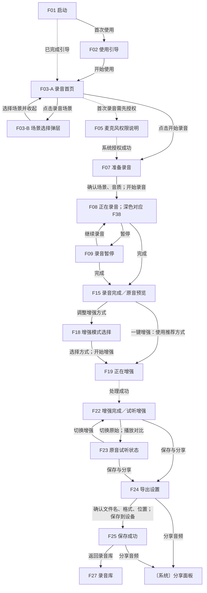
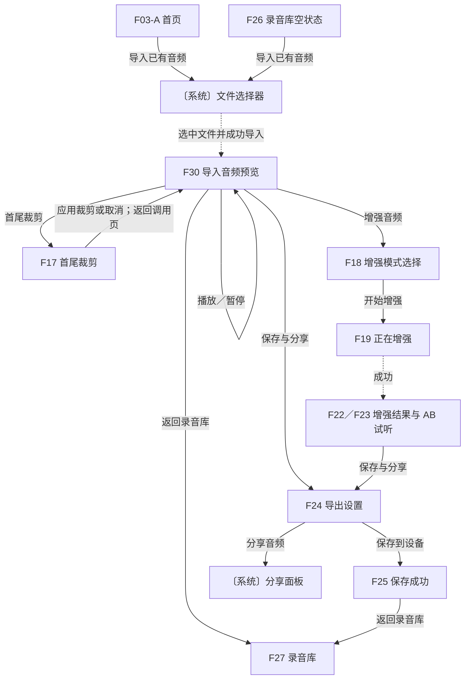
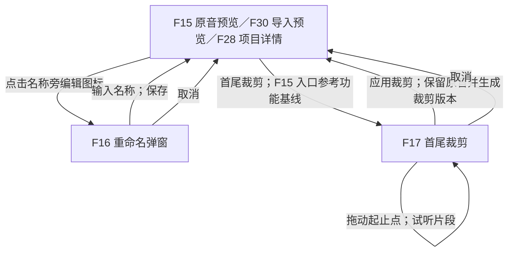
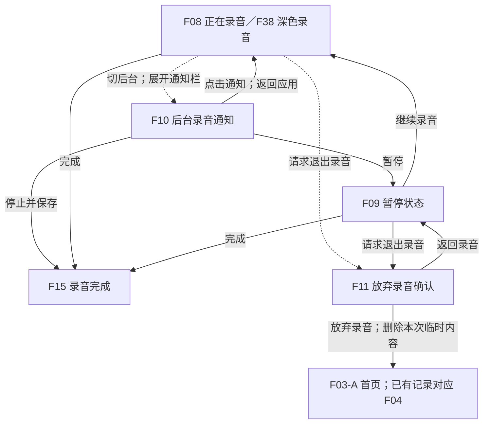
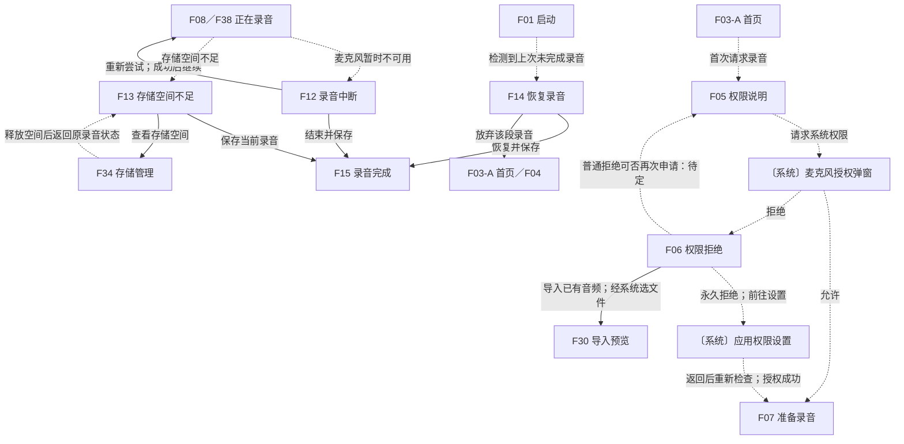
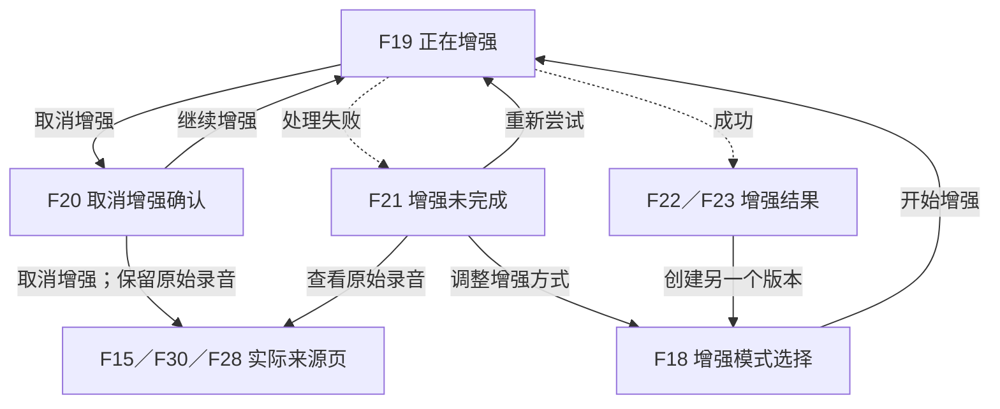
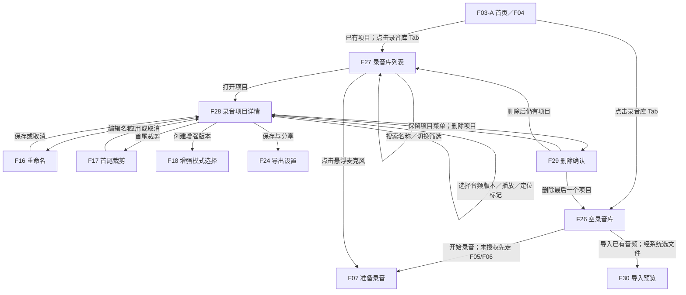
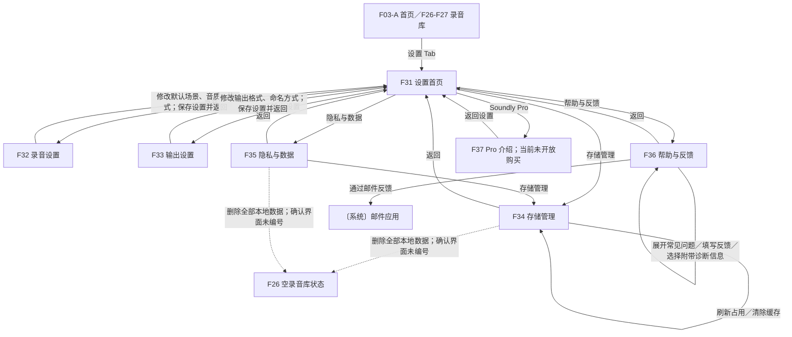

# Soundly 用户操作流程与高保真设计稿索引

更新：2026-11-14，F04/F05/F06 已补齐。完整实现准备评审见 [UI 设计稿完备性报告](UI设计稿完备性与实现准备评审报告.md)。

依据：逐张核对 `APP/` 下的 PNG；缺失场景参考 [M0 功能界面基线](../docs/M0_FUNCTIONAL_UI_BASELINE.md)。

## 阅读说明与设计稿核对

- 实线：设计稿可见的操作及其目标场景；虚线：系统触发、条件分支或根据功能基线补充的衔接。图中的箭头文字就是用户操作手顺。
- `〔系统〕`：Android 系统界面，无独立 F 编号；由平台提供，不是产品缺稿。
- 当前共 **39 张 PNG，覆盖全部 38 个 F 编号**：F03 有 A/B 两张，F04/F05/F06 已补齐。F03-B 与 F04 分别是“场景选择弹层”和“有最近录音的首页”。
- F22/F23 是结果页的增强/原始试听状态；F38 是 F08 的深色视觉状态，无需按编号依次访问。
- 本文梳理设计意图，不表示所有路径已通过应用实机验收。弹层关闭后返回调用页面；不同入口共用的页面在图中会重复出现。

## 一、主流程：首次使用 → 录音 → 增强 → 保存

操作要点：场景选择、暂停、AB 对比均为可选步骤。已授权时可从首页直接进入 F07；首次授权由 F05 衔接 Android 授权面板；F06 展示前往设置、导入和暂不录音。F15 的“一键增强”和“调整增强方式”是两条入口，不强制用户每次先进入 F18。原始项目已在本地保留，F24/F25 表示另行导出到设备或分享。

## 二、主流程：导入已有音频 → 编辑／增强 → 导出

导入不依赖麦克风权限。取消文件选择返回原入口。文件选择器、导入中和导入失败未提供独立设计稿编号，不能将 F30 当作文件选择界面。

## 三、次要流程：重命名与首尾裁剪

F16 的现有视觉稿以 F15 为背景；F30/F28 共用重命名弹窗的衔接根据名称编辑图标及功能基线整理。F17 应返回实际调用页面，不固定返回 F15。

## 四、次要流程：后台录音与放弃确认

F11 视觉稿背景为暂停状态，提供“返回录音”和“放弃录音”两个按钮，没有“保存”按钮。请求放弃时的暂停衔接按该设计呈现；F10 暂停后仍可停留通知栏，图中 F09 表示应用内对应状态。

## 五、异常流程：权限、中断、存储与恢复

F12 重试未成功时仍应停留中断状态；F13 不应假定清理空间后自动恢复录音，设计稿只明确“查看存储空间”和“保存当前录音”。F14 明确的是恢复已有内容并保存，未提供“恢复后继续录制”按钮。F05/F06 已有高保真稿；F06 当前未画“再次请求”按钮，普通拒绝是否重新走 F05、永久拒绝是否走系统设置仍需按评审报告冻结规则。

## 六、异常流程：增强取消与失败

取消和失败均保留原始音频。F21“查看原始录音”的确切落点按项目来源解析；F28 为项目来源上下文，若先进入独立预览则复用 F15/F30，不新增 F 编号。

## 七、次要流程：录音库、版本与删除

删除项目会清除项目内原音、版本和标记；F29 明确提示已导出到设备的文件不受影响。F27 搜索无结果、更多菜单本身未提供独立设计稿编号。

## 八、次要流程：设置、隐私、帮助与 Pro

F32/F33 点击“保存设置”后的提示与是否立即退出未单独展示，图中表示保存完成后返回设置的操作闭环。F34 从 F13 进入时返回 F13，从 F35 进入时返回 F35。清空全部本地数据后的 F26 表示录音库数据结果，不代表必须自动跳转。反馈通过用户的邮件应用发起；F37 无购买、支付或恢复购买流程。

## 九、按流程分组的设计稿对照表

“核心序号”用于分组归档；“复用／衔接”用于联调时检查完整手顺。相同页面可以被多个流程复用。

| 分组 | 流程类别 | 用户操作手顺 | 核心设计稿序号 | 复用／衔接序号 |
|---|---|---|---|---|
| G01 启动与首页 | 主流程入口 | 启动 → 引导 → 首页 → 可选场景选择 | F01、F02、F03-A、F03-B、F04 | F07、F14、F26/F27、F31 |
| G02 麦克风权限 | 前置／异常 | 请求权限 → 允许；拒绝后重试、系统设置或导入 | F05、F06 | F03-A、F07、F30 |
| G03 录音主操作 | 主流程 | 准备 → 录制 → 可选暂停/继续 → 完成 | F07、F08、F09、F38 | F15 |
| G04 后台与放弃 | 次要流程 | 后台通知控制／返回应用；退出时确认放弃 | F10、F11 | F08/F38、F09、F15、F03-A/F04 |
| G05 录音异常保护 | 异常流程 | 中断重试或保存；空间管理；重启恢复 | F12、F13、F14 | F01、F08/F38、F15、F34 |
| G06 原音预览与编辑 | 次要流程 | 播放原音 → 重命名／选取首尾 → 保存或取消 | F15、F16、F17 | F18/F19、F28、F30 |
| G07 音频增强与对比 | 主流程 | 选模式 → 增强 → 试听原音/增强 → 创建其他版本 | F18、F19、F22、F23 | F15、F24、F28、F30 |
| G08 增强取消与失败 | 异常流程 | 确认取消／继续；失败后重试或换模式 | F20、F21 | F18、F19、F15/F30/F28 |
| G09 保存与分享 | 主流程出口 | 设置导出 → 保存到设备 → 分享或返回库 | F24、F25 | F22/F23、F27、F28、F30 |
| G10 录音库与项目管理 | 次要流程 | 搜索筛选 → 详情 → 切换版本／删除确认 | F26、F27、F28、F29 | F07、F16、F17、F18、F24、F30 |
| G11 导入已有音频 | 主流程 | 首页/空录音库 → 系统选文件 → 导入预览 | F30 | F03-A、F26、F16、F17、F18、F24 |
| G12 偏好与数据管理 | 次要流程 | 设置 → 录音/输出偏好、存储或隐私管理 | F31、F32、F33、F34、F35 | F13、F26 |
| G13 帮助与 Pro | 次要流程 | FAQ/邮件反馈；查看 Pro 介绍并返回 | F36、F37 | F31 |

## 十、逐稿索引（点击序号打开原图）

| 序号 | 设计稿内容 | 归属组 | 入口 → 主要完成去向 |
|---|---|---|---|
| [F01](APP/F01.png) | 启动 | G01 | 打开应用 → F02 或首页；异常时 F14 |
| [F02](APP/F02.png) | 首次使用说明 | G01 | 首次启动 → F03-A |
| [F03-A](APP/F03-A.png) | 录音首页空状态 | G01 | F02/底部 Tab → F03-B、F07、导入、录音库、设置 |
| [F03-B](APP/F03-B.png) | 首页录音场景选择弹层 | G01 | F03-A 场景选择 → 选中/关闭返回首页 |
| [F04](APP/F04.png) | 首页有最近录音 | G01 | 回访首页 → 最近项目 F28、查看全部 F27、新录音、导入 |
| [F05](APP/F05.png) | 麦克风权限说明 | G02 | 点击录音 → 继续授权到系统弹窗；暂不录音回首页 |
| [F06](APP/F06.png) | 麦克风权限未开启 | G02 | 授权未开启 → 系统设置、导入已有音频或暂不录音 |
| [F07](APP/F07.png) | 准备录音 | G03 | 开始录音入口 → F08 |
| [F08](APP/F08.png) | 正在录音 | G03 | F07/F09 → F09、F10、F11、F12、F13、F15 |
| [F09](APP/F09.png) | 录音暂停 | G03 | F08 → 继续 F08、完成 F15 或放弃 F11 |
| [F10](APP/F10.png) | 后台录音通知 | G04 | 录音切后台 → 暂停、停止并保存或返回应用 |
| [F11](APP/F11.png) | 放弃录音确认 | G04 | 请求退出录音 → 返回录音或放弃回首页 |
| [F12](APP/F12.png) | 录音中断 | G05 | 麦克风不可用 → 重试或结束并保存 F15 |
| [F13](APP/F13.png) | 存储空间不足 | G05 | 录音空间不足 → F34 或保存到 F15 |
| [F14](APP/F14.png) | 异常录音恢复 | G05 | 启动发现未完成录音 → 恢复保存 F15 或放弃 |
| [F15](APP/F15.png) | 录音完成／原音预览 | G06 | 完成或恢复保存 → F16/F17、直接 F19 或调整 F18 |
| [F16](APP/F16.png) | 重命名录音弹窗 | G06 | 名称编辑 → 保存/取消返回调用页 |
| [F17](APP/F17.png) | 首尾裁剪 | G06 | 预览/详情 → 应用/取消返回调用页 |
| [F18](APP/F18.png) | 增强模式选择 | G07 | 预览、详情、失败调整、创建版本 → F19 |
| [F19](APP/F19.png) | 正在增强 | G07 | 开始增强 → F22、F20 或 F21 |
| [F20](APP/F20.png) | 取消增强确认 | G08 | F19 → 继续 F19 或取消返回来源上下文 |
| [F21](APP/F21.png) | 增强未完成 | G08 | F19 失败 → F19 重试、F18 调整或查看原音 |
| [F22](APP/F22.png) | 增强结果，增强版本选中 | G07 | 增强成功 → F23、F24 或 F18 |
| [F23](APP/F23.png) | 增强结果，原始版本试听 | G07 | F22 切换原始 → F22、F24 或 F18 |
| [F24](APP/F24.png) | 保存与分享／导出设置 | G09 | 结果或预览/详情 → F25 或系统分享 |
| [F25](APP/F25.png) | 保存成功 | G09 | F24 保存 → 系统分享或 F27 |
| [F26](APP/F26.png) | 录音库空状态 | G10 | 无项目时录音库 → F07 或导入 F30 |
| [F27](APP/F27.png) | 录音库列表 | G10 | 有项目时录音库 → 搜索筛选、F28、F07 |
| [F28](APP/F28.png) | 录音项目详情 | G10 | 打开项目 → 版本试听、F16、F17、F18、F24、F29 |
| [F29](APP/F29.png) | 删除项目确认 | G10 | F28 删除 → 保留 F28 或删除回 F27/F26 |
| [F30](APP/F30.png) | 导入音频预览 | G11 | 系统文件导入成功 → F16、F17、F18、F24 或 F27 |
| [F31](APP/F31.png) | 设置首页 | G12 | 设置 Tab → F32～F37 |
| [F32](APP/F32.png) | 录音设置 | G12 | F31 → 保存默认场景、音质、格式 |
| [F33](APP/F33.png) | 输出设置 | G12 | F31 → 保存默认格式、自动命名方式 |
| [F34](APP/F34.png) | 存储管理 | G12 | F31/F35/F13 → 查看占用、清缓存或删除本地数据 |
| [F35](APP/F35.png) | 隐私与数据 | G12 | F31 → 阅读说明、F34 或删除本地数据 |
| [F36](APP/F36.png) | 帮助与反馈 | G13 | F31 → FAQ、诊断信息选择、系统邮件反馈 |
| [F37](APP/F37.png) | Soundly Pro 介绍 | G13 | F31 → 查看开发中能力；返回 F31，当前无购买 |
| [F38](APP/F38.png) | 正在录音深色基准 | G03 | 与 F08 同功能同流程，按主题显示 |

## 十一、设计补齐与衔接关注项

| 项目 | 当前证据 | 流程处理方式 |
|---|---|---|
| F04/F05/F06 已补齐 | 当前 APP 目录已有三张图片 | 编号覆盖完整；权限普通拒绝与永久拒绝规则仍需明确 |
| 系统界面 | 授权、文件选择、应用权限设置、分享、邮件 | 以系统节点表示，不分配产品 F 序号 |
| 未单独编号的局部状态 | 更多菜单、搜索无结果、导入进度/失败、导出进度/失败、清缓存/清空数据确认与结果 | 未虚构为已有设计；后续补稿时可使用对应 F 的子状态命名 |
| 弹层及编辑返回位置 | F16/F17/F20 可从不同页面调用 | 返回实际来源上下文，避免固定跳回某一预览页 |
| F15 直接导出入口 | 功能基线定义预览支持导出；现有 F15 正面仅展示增强入口及更多菜单 | 不将不可见按钮画作已确定入口；可从库详情 F28 进入 F24，更多菜单需补充确认 |
| 设置保存后的表现 | F32/F33 有保存按钮，未展示保存后状态 | 以“保存并返回”的用户闭环表达，不限定自动退出行为 |
| Pro 商业化 | F37 明示当前未开放购买 | 流程终点为返回设置，不添加支付路径 |
