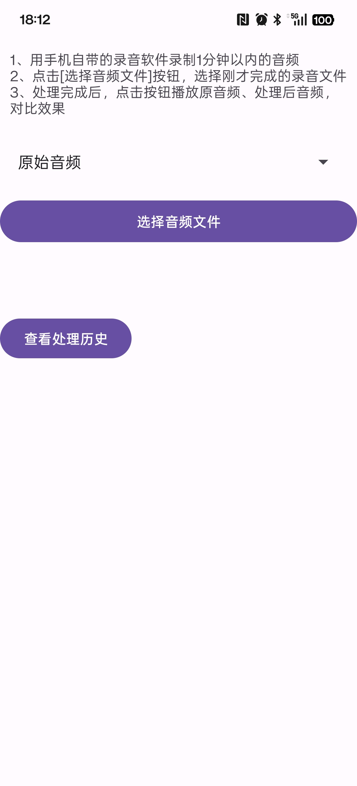
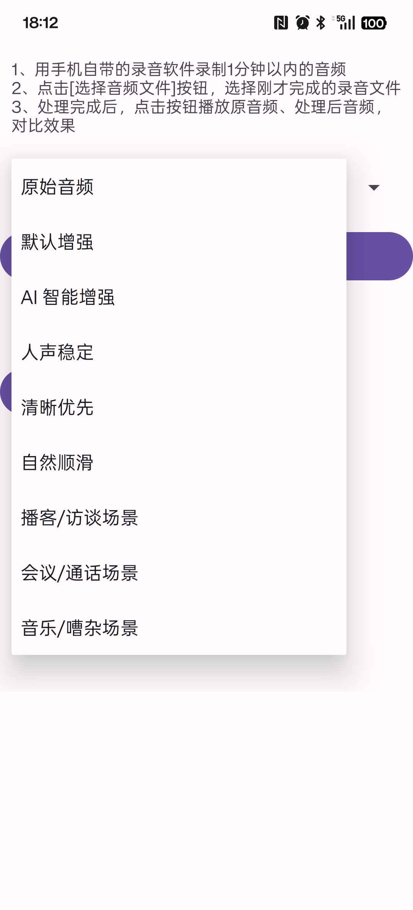
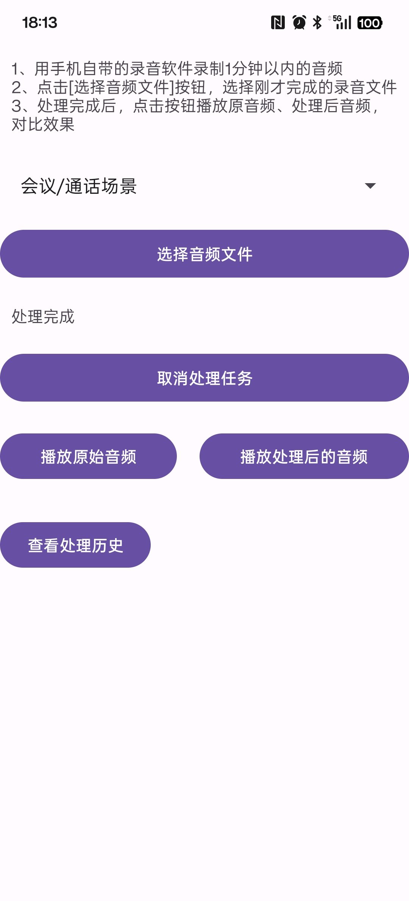
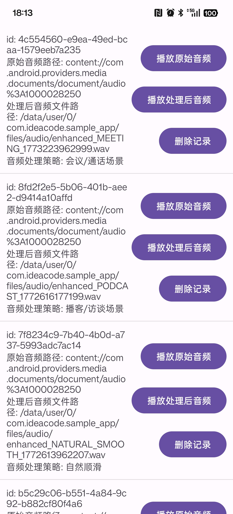

# Soundly

🎧 **Soundly** 是一个面向 Android 的轻量级音频处理 SDK，提供音频解码、分析、DSP 处理以及播放能力，帮助开发者快速构建高质量的音频处理应用。

Soundly 的设计目标是：**让复杂的音频处理流程变得简单、清晰、可扩展**。

## App 实施基线

面向最终 Soundly App 的 38 个功能场景、导航、SDK 状态来源和高保真 UI 迁移边界已固化在 [M0 功能界面基线](docs/M0_FUNCTIONAL_UI_BASELINE.md)。第一阶段使用 Material XML 实现真实功能，不把临时视觉当作最终设计。


一文了解 Soundly-SDK 运行机制：https://juejin.cn/post/7616666565057478671

---

## 📱 sample-app 运行截图
<p align="left">
  
  
  
  
</p >

## ✨ Features

- 🎧 **Audio Decode**  
  基于 Android `MediaCodec` 的音频解码能力

- 🧠 **Audio Analyzer**  
  音频特征分析能力，用于识别音频特征信息

- 🎚 **DSP Processing Pipeline**  
  模块化 DSP 处理管线

- 🔊 **PCM Data Processing**  
  完整的 PCM 数据处理流程

- 📀 **WAV Export**  
  支持音频处理结果导出为 WAV 文件

- ▶️ **Audio Player**  
  内置音频播放能力

- 📊 **Processing History**  
  支持音频处理历史记录

---


## 📦 Project Structure
soundly  
├─ soundly-core        # 核心音频处理能力  
├─ soundly-sdk         # 对外 SDK 接口  
└─ sample-app          # 示例应用  

模块职责：

| Module | Description |
|------|-------------|
| soundly-core | 音频解码、分析、DSP 处理 |
| soundly-sdk | 对外 API 接口 |
| sample-app | 示例 App |

---

## ⚡ Getting Started

### 1. Clone 项目

git clone https://github.com/andyliu900/Soundly.git

### 2 添加依赖

（1）如果通过 module 引入：

```gradle
dependencies {
    implementation(project(":soundly-sdk"))
}
```

（2）构建 aar ，通过 aar 进行引入：
如果是希望通过 aar 方式进行引入，需要按照以下步骤进行集成

在 app 层根目录新增 libs 文件夹

运行 gradle 脚本，生成 aar 文件
```Gradle
./gradle publishReleasePublicationToMyRepoRepository
```
生成的 aar 文件会存放在根目录 /repo 目录下，将 aar 文件复制到 libs 目录下

app 层 gradle 配置增加以下内容
由于脚本构建的 aar 包不会携带第三方组件，需要在 app 层的 gradle 配置增加 room、timber 配置
```Gradle
    // 使用 aar 形式需要配套增加 room、timber 组件
    implementation(files("libs/soundly-sdk-1.0.6.aar"))
    implementation(libs.room.runtime)
    implementation(libs.room.ktx)
    implementation(libs.timber)
    implementation(libs.kotlinx.coroutines.core)
```

### 3 初始化SDK

```kotlin
class App : Application() {
    override fun onCreate() {
        super.onCreate()

        when (val result = Soundly.initialize(this)) {
            is SoundlyResult.Success -> Unit
            is SoundlyResult.Failure -> {
                error("Soundly initialization failed: ${result.error.code}")
            }
        }
    }
}
```

`Soundly.init(context)` 仅作为 1.x 兼容入口保留。依赖容器已从源码 API 中隐藏，
新代码统一通过 `Soundly.initialize(context)` 和 `Soundly.sdk()` 访问 SDK；无法保证
初始化时可使用 `Soundly.sdkResult()` 获取类型化的 `NotInitialized` 结果。

### 4 处理音频

```kotlin
val result = Soundly.sdk().processor.process(
    request = ProcessingRequest(
        source = AudioSourceRef.ContentUri(uri),
        presetOption = selectedPreset,
        outputFileName = "enhanced_${System.currentTimeMillis()}"
    )
) { progress ->
    // progress.stage / progress.percent
}

when (result) {
    is SoundlyResult.Success -> {
        val outputPath = result.value.outputFilePath
    }
    is SoundlyResult.Failure -> {
        val stableErrorCode = result.error.code
    }
}
```

SDK 2.0 的录音、项目内增强、统一播放、裁剪、导出和存储能力均通过
`Soundly.sdk()` 获取。宿主界面无需访问 SDK 内部实现类。

### 5 导入音频并观察项目库

Soundly 会读取 URI 的真实音频轨道信息，并将支持的 WAV、M4A、AAC 或 MP3
原子复制到 SDK 私有项目目录。源 URI 不需要被 SDK 长期持有。

```kotlin
val metadataResult = Soundly.sdk().metadata.read(uri)

val importResult = Soundly.sdk().importer.importAudio(
    AudioImportRequest(
        source = uri,
        title = "Meeting notes"
    )
)

when (importResult) {
    is SoundlyResult.Success -> {
        val projectId = importResult.value.project.id
    }
    is SoundlyResult.Failure -> {
        val errorCode = importResult.error.code
    }
}
```

项目库支持 Flow 观察、查询、搜索、重命名、版本和标记管理：

```kotlin
Soundly.sdk().projects.observeProjects().collect { projects ->
    // Render the recording library.
}
```

数据库可从旧版 Schema 2 非破坏升级到 Schema 4。旧的处理历史会迁移成项目及其
原始/增强版本；新文件统一保存在 `files/soundly/projects/{projectId}` 下。

### 6 录音、暂停、标记与恢复

SDK Manifest 已声明录音和前台服务权限。宿主 App 必须在调用 `prepare` 前主动向
用户申请 `RECORD_AUDIO`；Android 13 及以上还应申请 `POST_NOTIFICATIONS`，以完整
显示后台录音控制通知。权限解释和申请界面由宿主 App 负责。

```kotlin
val recorder = Soundly.sdk().recorder

recorder.prepare(
    RecordingConfig(
        title = "Weekly meeting",
        scene = RecordingScene.MEETING,
        format = AudioFormat.M4A
    )
)
recorder.start()

// UI 可分别收集 recorder.state / meter / waveform。
recorder.addMarker("Action item")
recorder.pause()
recorder.resume()

val recordingResult = recorder.stopAndSave()
```

录音进行时 SDK 使用 microphone 类型前台服务，并提供暂停、继续和停止通知操作。
恢复信息会持续写入 Room；应用再次启动后可调用：

```kotlin
val pending = Soundly.sdk().recorder.getRecoverableRecordings()
Soundly.sdk().recorder.recover(sessionId)
```

### 7 项目内增强与试听切换

```kotlin
val enhanced = Soundly.sdk().enhancer.enhance(
    projectId = projectId,
    sourceVariantId = originalVariantId,
    preset = PresetOption.DEFAULT
) { progress ->
    // progress.stage / progress.percent
}

val playback = Soundly.sdk().playback
playback.prepare(AudioSourceRef.LocalFile(originalFile))
playback.play()

// 切换到增强版时保留当前进度和播放/暂停状态。
playback.switchSourceKeepingPosition(AudioSourceRef.LocalFile(enhancedFile))
```

增强结果会自动保存为项目的 `ENHANCED` 版本，不会成为无法管理的孤立文件。

### 8 裁剪、导出和空间管理

```kotlin
val trimPreview = Soundly.sdk().trimmer.previewTrim(
    projectId,
    sourceVariantId,
    TrimRange(startMs = 5_000, endMs = 35_000)
)

// 用户确认预览范围后，再非破坏性地生成裁剪版本。
Soundly.sdk().trimmer.applyTrim(
    projectId,
    sourceVariantId,
    TrimRange(startMs = 5_000, endMs = 35_000)
)

Soundly.sdk().exporter.export(
    ExportRequest(
        projectId = projectId,
        variantId = variantId,
        displayName = "meeting-clean",
        format = AudioFormat.WAV,
        destination = ExportDestination.Downloads
    )
) { progress ->
    // PREPARING / ENCODING / WRITING / COMPLETED，以及 0..100 的 percent
}

// 也可以直接使用持久化的默认输出格式，并用项目标题生成文件名。
Soundly.sdk().exporter.exportUsingDefaults(
    projectId = projectId,
    variantId = variantId,
    destination = ExportDestination.Downloads
)

// 分享所选版本：SDK 生成只读 content:// URI 和 ACTION_SEND Intent。
val shareResult = Soundly.sdk().exporter.prepareShare(
    ShareRequest(
        projectId = projectId,
        variantId = variantId,
        displayName = "会议增强版"
    )
)
if (shareResult is SoundlyResult.Success) {
    startActivity(
        Intent.createChooser(
            shareResult.value.sendIntent,
            getString(R.string.share_recording)
        )
    )
}

val usage = Soundly.sdk().storage.snapshot()
Soundly.sdk().storage.clearCache()
```

裁剪当前支持 PCM WAV 和 M4A，且不会覆盖原文件。裁剪版本会记录来源版本以及
`trimStartMs`/`trimEndMs`，来源版本存在派生版本时不会被误删。

导出不会伪装转码：源格式与目标格式相同时直接无损复制；M4A、AAC、MP3 可以用流式
解码导出为 PCM16 WAV，不会把整段 PCM 一次性放入内存。首版尚不支持 WAV 转 M4A/AAC
等其他重新编码组合，SDK 会明确返回 `UnsupportedFormat`。Android 10 及以上通过
MediaStore 导出，其中 Music 和 Downloads 使用各自对应的系统集合；Android 8～9
由宿主 App 申请旧版外部存储写权限。中文、空格等 Unicode 文件名会被保留，只会替换
系统不允许的路径字符。

如需让用户选择任意位置，先启动 SDK 创建的系统“另存为”Intent，再把返回 URI 作为
`DocumentUri` 执行导出：

```kotlin
val intentResult = Soundly.sdk().exporter.createDocumentIntent(
    displayName = "会议增强版",
    format = AudioFormat.WAV
)
if (intentResult is SoundlyResult.Success) {
    createDocumentLauncher.launch(intentResult.value)
}

// Activity Result 回调中：
Soundly.sdk().exporter.export(
    ExportRequest(
        projectId = projectId,
        variantId = variantId,
        displayName = "会议增强版",
        format = AudioFormat.WAV,
        destination = ExportDestination.DocumentUri(requireNotNull(result.data?.data).toString())
    )
)
```

分享功能通过 SDK 自带的 FileProvider 暴露只读缓存副本，不会暴露项目私有文件路径，
宿主 App 无需额外声明 Provider。分享缓存计入 `storage.snapshot().cacheBytes`，可通过
`storage.clearCache()` 清理；系统分享期间不要主动清理缓存。

### 9 持久化默认设置

```kotlin
val settings = Soundly.sdk().settings

settings.update(
    SoundlySettings(
        defaultScene = RecordingScene.MEETING,
        recordingQuality = RecordingQuality.HIGH,
        recordingFormat = AudioFormat.M4A,
        outputFormat = AudioFormat.WAV,
        recordInBackground = true,
        namingStrategy = RecordingNamingStrategy.DATE_TIME
    )
)

// 自动将持久化设置映射成 RecordingConfig。
Soundly.sdk().recorder.prepareUsingDefaults(title = "Weekly meeting")
```

设置保存在 SDK 私有 `SharedPreferences`，支持 Flow 观察、读取、更新和恢复默认值。
`storage.deleteAllLocalData()` 会在没有录音任务运行时清理项目、恢复会话、旧历史、
SDK 管理文件并恢复默认设置。

## 📖 Example Workflow
Soundly 的处理流程如下：

```agsl
Audio File
↓
MediaCodec Decoder
↓
Audio Analyzer
↓
DSP Pipeline
↓
Audio Processor
↓
Output (Wav / Player)
```

## 📱 Sample App
项目提供 sample-app 用于演示完整功能：  
功能包括：  
- 音频导入
- 音频处理
- 处理历史记录
- 音频播放

## 🛠 Tech Stack
- Kotlin
- Android MediaCodec
- Coroutine
- DSP Audio Processing
- Room (History Storage)

## 🤝 Contributing
欢迎提交 Issue 或 Pull Request 来帮助改进 Soundly。  

贡献方式：  
- Fork 本仓库  
- 创建 Feature 分支  
- 提交代码  
- 提交 Pull Request  

## ⭐ Support
如果这个项目对你有帮助，欢迎：  
- ⭐ Star 本仓库  
- 🐞 提交 Issue  
- 🔧 提交 Pull Request  

你的支持将帮助项目持续改进。
