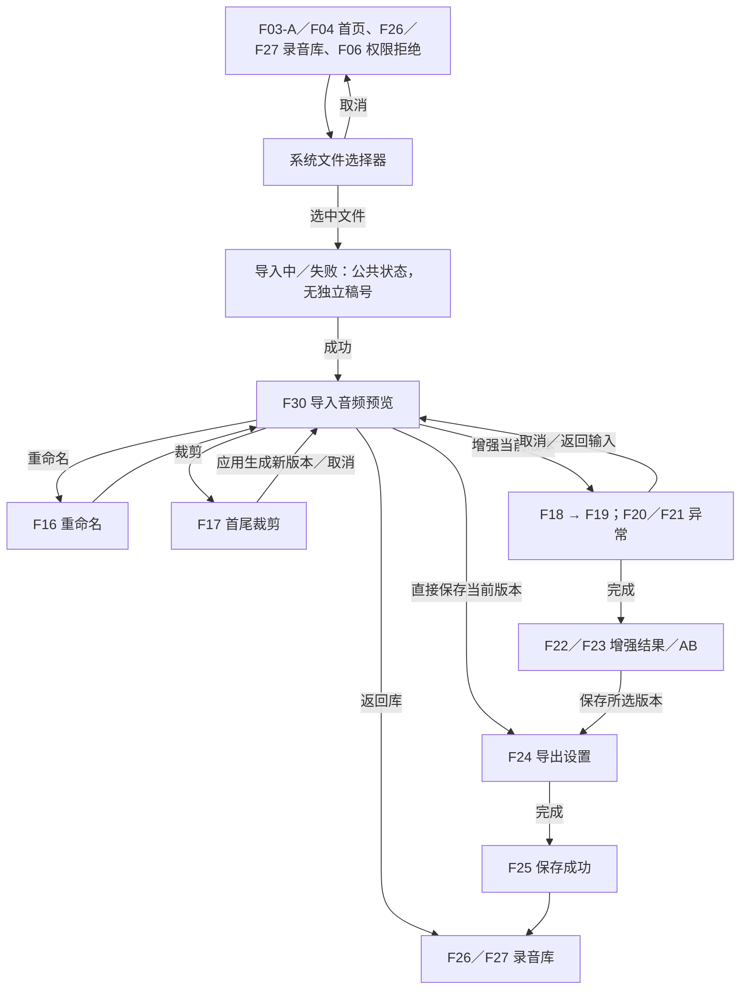

# 导入音频 → 编辑／增强 → 导出：代码落地里程碑

整理日期：2026-11-16。I0～I5 已落地，I6 已完成自动化与模拟器联调，真机／真实云服务验收待完成。目标模块为现有 `:soundly-app`（目录 `soundly-app/`）；采用 Kotlin、Fragment、XML、ViewBinding、Material 3、Navigation 和协程 Flow。音频处理与持久化继续通过 SDK/Gateway 完成。使用 I0～I6 编号，避免与既有录音主线 H0～H8 混淆。

## 1. 流程与界面范围

| 分组 | 设计稿 | 本轮范围 |
|---|---|---|
| 导入入口 | F03-A、F04、F06、F26、F27；系统文件选择器 | 首页、权限拒绝引导、空库和非空库可发现导入入口；不申请麦克风权限 |
| 导入与编辑 | F30、F16、F17 | 真实导入、预览、重命名、非破坏性首尾裁剪；进度、错误及空态使用公共组件，暂无独立设计稿 |
| 增强及导出 | F18～F25 | 复用既有实现，补导入／裁剪来源、版本语义及导航适配，支持不增强直接导出 |
| 项目上下文 | F27、F28 | 库显示导入项目；详情仅补足定位与识别裁剪版本所必需的内容，不做完整项目管理重设计 |
| 适配 | F38 为录音页深色参考 | F30/F17 及复用页面适配浅色、深色、小屏、大字体和系统栏；不把 F38 当作导入页面设计稿 |

## 2. 现状与关键差距

| 项目 | 当前代码事实 | 需补齐 |
|---|---|---|
| 导入 | 首页已有 `OpenDocument` 和 `HomeViewModel` 导入；库与录音准备页也各有独立入口；Gateway 将 SDK 导入结果缩减为项目 ID | 统一操作编排、错误和生命周期；库当前失败分支为空；成功后仍进入 F15 而不是 F30 |
| SDK 导入 | `DefaultAudioImporter` 读取元数据、复制到私有目录并创建 `IMPORTED` 项目；接口无进度回调或公开任务 ID | 不展示虚假百分比；核实取消、事务清理、云文件与进程终止后的结果确认，必要时窄范围扩展 SDK |
| F30 元数据 | 模型有项目名称、格式、时长、大小，但 `AudioProject` / `AudioVariant` 没有原始文件显示名字段 | 原文件名不能用修改后的项目名冒充；优先规划可选元数据及兼容迁移，无法可靠获取时显示“来源文件名不可用” |
| 波形 | `loadStaticWaveform` 只读取已持久化波形；当前导入器未生成波形 | 需 SDK 提供受控、可缓存的真实波形生成/读取能力，或明确不可用状态；不得绘制示例波形充当真实数据 |
| 裁剪 | `TrimFragment` 使用两个滑块、Fragment 内协程，成功新建预览页；SDK 裁剪创建新版本并返回真实 ID | F17 波形、选区、试听、范围保护、执行态和来源返回；不可依赖传入的旧时长作为唯一事实 |
| 格式 | 导入识别 WAV/M4A/AAC/MP3，实际仍取决于文件和设备解码；SDK 裁剪当前仅 WAV/M4A | AAC/MP3 不应显示为可直接裁剪；提供明确说明，仍允许可用的增强/导出。若产品要求直接裁剪，先扩展 SDK 并测精度，不在 App 静默转换 |
| 增强与导出 | H6/H7 已有输入版本、AB、实际导出结果和分享能力 | 将裁剪版本作为本次输入完整传递；确认返回实际来源、AB 文案及选中版本，避免把“处理前”误称项目最初原音 |

## 3. 分组里程碑

| 组别 | 阶段 | 界面／设计稿 | 实现内容 | 完成标志 |
|---|---|---|---|---|
| A 契约与基础 | **I0 规则冻结与能力补齐方案（已完成）** | F30/F17、系统选择器、异常状态 | 冻结来源与版本、URI 授权、复制/进程恢复、支持格式、波形和裁剪精度；确定缺稿状态、SDK 改动范围及返回栈 | [I0 契约](IMPORT_FLOW_I0_CONTRACT.md)记录状态表、失败处理、能力矩阵及后续任务；裁剪能力规则已接 SDK |
| B 选择与导入 | **I1 导入入口与可靠导入（已完成）** | F03-A/F04、F06、F26/F27、系统选择器 | 统一入口与单次导入；取消不报错；等待、防重复、失败重试；成功取得项目和原始版本 ID；必要 SDK 原子性／恢复补强 | [I1 交付记录](IMPORT_FLOW_I1_PROGRESS.md)记录实现、验证与后续设备验收事项 |
| B 选择与导入 | **I2 F30 导入预览（已完成）** | F30、复用 F16 | 高保真导入成功状态、真实元数据/波形/播放器、重命名、裁剪/增强/直接导出/返回库；日夜主题 | [I2 交付记录](IMPORT_FLOW_I2_DELIVERY.md)记录功能、验证及 I3 后续工作 |
| C 非破坏编辑 | **I3 F17 首尾裁剪（已完成）** | F17 | 真实波形双端选区、时间与范围校验、选区试听、应用中/错误、防重及新版本返回；保留来源 | WAV/M4A 实际生成可播放裁剪版本，取消保留原版本，应用后当前版本明确切换；详见 [I3 交付记录](IMPORT_FLOW_I3_DELIVERY.md) |
| D 处理与交付 | **I4 增强／AB 适配（已完成）** | F18～F23 | 输入为 F30 当前选中原始或裁剪版本；取消/失败回实际来源；AB 比较本次输入与对应增强输出 | 版本链不串用、播放切换及导出选择正确，录音路径回归通过；详见 [I4 交付记录](IMPORT_FLOW_I4_DELIVERY.md) |
| D 处理与交付 | **I5 导出、分享与库闭环（已完成）** | F24/F25、F26/F27、必要的 F28 | 原音、裁剪、增强版本均可走现有导出；准确展示所选版本；保存后回库并可重新打开 | 输出内容、名称/格式与真实结果一致；分享所选源版本的语义清楚；返回不重复导出；详见 [I5 交付记录](IMPORT_FLOW_I5_DELIVERY.md) |
| E 验收 | **I6 联调与发布门禁（自动化已实施，真机待验收）** | 上述全部 | 状态机与导航、格式/文件边界、配置重建和进程终止、视觉适配、权限与真实文件/设备验证 | 正常链路和关键异常均有记录；未完成真机事项明确列出，不以构建通过代替验收；详见 [I6 验收记录](IMPORT_FLOW_I6_ACCEPTANCE.md) |

依赖：I0 → I1 → I2 → I3 → I4 → I5 → I6。I2 阶段可先打通原音直出，I4/I5 再做完整版本链与回归；F17 的 SDK 能力确认应在 I0 提前进行。

## 4. 各阶段代码落点

| 阶段 | 预计修改的现有代码 | 拟新增／扩展 | 实施要点 |
|---|---|---|---|
| I0 | `docs/MAIN_FLOW_H0_CONTRACT.md` 的相关增量或单独导入契约；`EditingGateway.kt`；SDK importer/trimmer 接口与存储实现按核查结果调整 | 导入流程状态／来源／格式规则表 | 明确任务所有者、结果确认和提交边界；不能把 URI 字符串写入状态就认为重启后仍有授权 |
| I1 | `HomeFragment.kt` / `HomeViewModel.kt`、`LibraryFragment.kt`、`PrepareRecordingFragment.kt`、`fragment_library.xml`、`app_navigation.xml`、`AppContainer.kt`、`EditingGateway.kt`、错误映射 | 按需 `ImportViewModel`、`ImportAudioUseCase`、可复用系统文件选择器协调器及状态 UI | `OpenDocument` 返回 URI 由平台层处理；保持一个业务所有者；后台或重建时避免重复写入，若无法确认之前结果就先提示核查，不自动重导 |
| I1/I2 | SDK `DefaultAudioImporter.kt`、音频元数据/项目持久化、波形生成接口；App `ProjectGateway.kt`，仅在能力缺口确认后修改 | 可选原始显示名字段及数据库迁移；真实波形的缓存／生成用例 | 导入源成功复制后可独立使用；原始显示名不等于项目名，旧记录和获取失败需安全回退；波形失败不阻塞播放 |
| I2 | `AudioPreviewFragment.kt`、`AudioPreviewViewModel.kt` / Renderer、`fragment_audio_preview.xml`、`RenameProjectDialog.kt`、`MainActivity.kt`、`app_navigation.xml` | F30 独立布局/渲染策略，按代码复用程度选择独立 Fragment 或复用共享预览能力；共用播放器与固定顶部栏 | F15 与 F30 不复制播放器/状态机；项目来源及当前版本驱动标题、信息和按钮；F16 重命名改项目名而非源文件 |
| I3 | `feature/editing/TrimFragment.kt`、`fragment_trim.xml`、`EditingGateway.kt`、`ProjectGateway.kt`、导航和 F30 | `TrimViewModel`、范围策略、可访问的双端波形选择控件、裁剪 UseCase | 加载项目/版本的真实时长；SDK `previewTrim` 可返回完整 `TrimPreview` 而非只保留时长；监听实际 `TrimResult.variantId`，返回调用上下文并刷新当前版本 |
| I4 | `EnhancementSetupFragment.kt`、`EnhancementProgressFragment.kt`、`EnhancementResultViewModel.kt` / Renderer、相关文案和导航 | 必要的来源上下文及版本文案策略 | “处理前”对应本次 `sourceVariantId`；AB 只在可对齐的版本间保持时间位置，长度差异按实际时长约束；取消或失败回 F30 的相同版本 |
| I5 | `ExportViewModel.kt` / `ExportFragment.kt`、`LibraryFragment.kt` / Adapter、必要的 `ProjectDetailFragment.kt`、导航及文案 | 最小版本标签与来源展示 | 沿用 SDK 的导出能力表、同名处理和结果恢复；确保 F24/F25 对裁剪版本不误标为原始或增强 |
| I6 | `src/test/`、`src/androidTest/` 及验收文档；只修验证中发现的问题 | 导入主流程集成测试、真实设备记录 | 使用隔离测试文件和 `ContentProvider`，覆盖本地/云 URI、授权失效、异常与版本链，避免破坏用户数据 |

## 5. 必须先明确的契约

| 事项 | 建议规则与限制 |
|---|---|
| 操作与生命周期 | 保存操作草稿和结果 ID，耗时任务放在合适的 ViewModel/流程作用域，页面只收集 Flow；系统选择结果和一次性导航须确认消费。进程被杀后的恢复需持久化提交标识或可靠核验机制，SDK 当前导入接口没有外部指定任务 ID，不能仅凭时间或文件名推断成功。 |
| URI 和权限 | 用系统文件选择器的读取授权；立即复制到 App 私有目录。若需跨进程续读，仅在 provider 支持且授权确实获取成功时使用持久授权；失效则重新选择，不能依赖已失效 URI 静默重试。 |
| 导入进度和取消 | 现有 SDK 无公开进度/任务取消契约：首版显示不确定等待与明确错误，除非先补可测试的 SDK 能力，不显示假百分比或声称可取消。审查 `CancellationException`、复制临时文件及落库边界，避免取消/进程终止留下半成品或重复项目。 |
| 裁剪范围 | `0 ≤ start < end ≤ 实际时长`；最短片段与长音频精细选择在 I0 明确。现有 SDK 未规定产品层最短长度；压缩格式受采样帧影响，展示实际产物时长，精度由格式和设备实测确定。 |
| 裁剪返回 | 取消回调用页且不改变选择；成功返回实际调用上下文并将 SDK 返回版本选为当前版本。原项目与原文件不被覆盖；处理成功后页面重建不重新创建版本。 |
| 输出与分享 | 所有操作显式传 `projectId + variantId`；缺失报错，不回退其他版本。F24 按 H7 固定下载目录及可用格式导出；分享的是当前所选源版本，而不是保证分享转换后的导出文件。 |
| 视觉缺稿 | 导入等待/失败、空波形、F17 非法范围/应用中/失败、来源文件名缺失及多版本上下文没有独立高保真稿；先采用 Material 公共组件和可辨识文案，实施时记录并请产品按需补稿。 |

## 6. 分阶段验证

| 阶段 | 重点验证 |
|---|---|
| I0/I1 | 各入口、取消选择、重复点击、格式与损坏文件、不可读/权限失效、空间不足、provider 未知文件大小、网络中断；复制／落库边界及进程中断不产生伪成功或重复项目。 |
| I2 | 导入项目真实元数据、可播放/定位、波形成功/失败、重命名、浅深色、重建及来源文件名缺失；导入成功后原 URI 不可用仍可读取本地副本。 |
| I3 | 起终点边界、极短／长文件、左右手柄可访问性、试听结束边界、取消/失败保留选区、防重、WAV/M4A 输出可播放、时长和源文件不变；AAC/MP3 限制提示。 |
| I4/I5 | 原版/裁剪版分别增强，AB 选中版本进入导出，取消/失败回来源；验证真实文件内容、格式和分享 URI，保存后项目可在库中重开；回归录音来源现有流程。 |
| I6 | 单元与仪器测试、Navigation 和生命周期/进程终止、API 26/33/35+ 模拟器及真机、本地与云文档、横竖屏、小屏/大字体、系统栏和深浅色；记录环境、结果与未完成项目。 |

相关基线：[主流程实现里程碑](MAIN_FLOW_IMPLEMENTATION_MILESTONES.md)、[H0 契约](MAIN_FLOW_H0_CONTRACT.md)、[H7 交付记录](MAIN_FLOW_H7_DELIVERY.md)、[H8 验收记录](MAIN_FLOW_H8_ACCEPTANCE.md)、[设计稿流程索引](../ProjectUI/用户操作流程与设计稿索引.md)。
