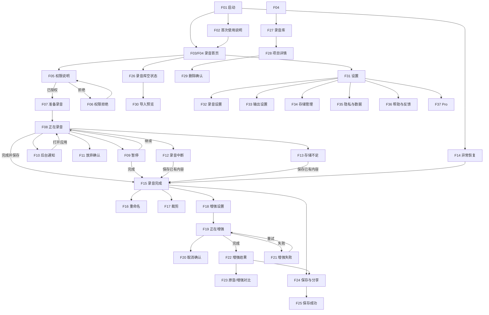

# Soundly M0：功能界面基线

状态：已冻结为第一阶段（Material 功能版）实施基线。
范围：`soundly-app`，对接 `soundly-sdk 2.0.0`。
非目标：本文件不规定最终视觉、颜色、字号、间距、圆角、动效或高保真布局。

## 1. 实施原则

第一阶段交付的是 **38 个可达、可操作、可验证的功能场景**，不是 38 张最终设计页面。

- 页面采用 Android View XML 和 Material Components 的默认/轻度定制外观。
- 每一个 UI 场景先定义功能契约：入口、真实数据、用户动作、状态变化、去向与错误处理。
- `soundly-app` 只做权限、导航、状态编排和展示；不复制 SDK 的录音、文件、项目数据库、DSP 或导出业务。
- ViewModel 只暴露 `UiState`、接收 `UiAction`、发送一次性 `UiEffect`；不得依赖 `View`、`Fragment` 或布局资源。
- 高保真迁移只允许替换 XML、Style、Drawable、Renderer 和自定义 View 的绘制；不得变更页面路由、`UiAction`、`UiState`、UseCase 或 SDK Gateway 契约。

## 2. 场景编码与实现单元

| 场景 | 功能名称 | 第一阶段实现单元 | 入口 / 完成结果 |
|---|---|---|---|
| F01 | 启动 | `SplashActivity`/启动主题 | 初始化 SDK；路由 F02、F03 或 F04 |
| F02 | 首次使用说明 | `OnboardingFragment` | 完成引导后进入 F03 |
| F03 | 录音首页空状态 | `HomeFragment` | 开始录音、导入、打开设置或录音库 |
| F04 | 录音首页有最近录音 | `HomeFragment` | 与 F03 共用布局；展示最近项目 |
| F05 | 麦克风权限说明 | `PermissionBottomSheet` | 发起 `RECORD_AUDIO` 请求 |
| F06 | 麦克风权限拒绝 | `PermissionBottomSheet` | 再次请求、跳系统设置或导入音频 |
| F07 | 准备录音 | `PrepareRecordingFragment` | 配置标题/场景/质量，进入 F08 |
| F08 | 正在录音 | `RecordingFragment` | 实时状态、波形、标记、暂停、完成 |
| F09 | 录音暂停 | `RecordingFragment` | 共用 F08；继续、完成或放弃 |
| F10 | 后台录音通知 | SDK 前台服务 + App 路由 | 暂停/继续/完成，点击通知回录音页 |
| F11 | 放弃录音确认 | `DiscardRecordingDialog` | 继续、保存或丢弃临时录音 |
| F12 | 录音中断 | `RecordingFragment` 状态 | 显示 SDK 中断原因；继续、保存或退出 |
| F13 | 存储不足 | `RecordingFragment` 状态 | 保存已有内容、前往 F34 |
| F14 | 异常录音恢复 | `RecoveryBottomSheet` | 恢复、保存已有内容或丢弃 |
| F15 | 录音完成/原音预览 | `AudioPreviewFragment` | 播放、重命名、裁剪、增强、导出 |
| F16 | 重命名录音 | `RenameProjectDialog` | 保存项目新名称 |
| F17 | 首尾裁剪 | `TrimFragment` | 预览/应用非破坏裁剪，生成新版本 |
| F18 | 增强模式选择 | `EnhancementSetupFragment` | 选择 preset，创建增强任务 |
| F19 | 正在增强 | `EnhancementProgressFragment` | 展示任务阶段、进度，取消或等待完成 |
| F20 | 取消增强确认 | `CancelEnhancementDialog` | 继续或取消任务 |
| F21 | 增强失败 | `EnhancementProgressFragment` 状态 | 重试、更换模式或返回预览 |
| F22 | 增强结果 | `EnhancementResultFragment` | 播放结果、查看摘要、导出、创建版本 |
| F23 | 原音/增强 AB 对比 | `EnhancementResultFragment` 状态 | 同位置切换版本试听 |
| F24 | 保存与分享 | `ExportBottomSheet` | 选择导出目标/质量，启动导出或分享 |
| F25 | 保存成功 | `ExportBottomSheet` 状态 | 显示真实输出位置，打开/分享/返回项目 |
| F26 | 录音库空状态 | `LibraryFragment` | 开始录音或导入音频 |
| F27 | 录音库正常状态 | `LibraryFragment` | 搜索、播放、打开项目、创建录音 |
| F28 | 录音项目详情 | `ProjectDetailFragment` | 版本、标记、播放、编辑、删除 |
| F29 | 删除项目确认 | `DeleteProjectDialog` | 取消或删除项目及内部文件 |
| F30 | 导入音频预览 | `AudioPreviewFragment` 状态 | 导入后进入，与 F15 共享操作 |
| F31 | 设置首页 | `SettingsFragment` | 跳转 F32～F36、F37 |
| F32 | 录音设置 | `RecordingSettingsFragment` | 保存默认录音设置 |
| F33 | 输出设置 | `OutputSettingsFragment` | 保存默认导出设置 |
| F34 | 存储管理 | `StorageManagementFragment` | 查看统计、清缓存、删除本地数据 |
| F35 | 隐私与数据 | `PrivacyFragment` | 展示本地数据边界和删除入口 |
| F36 | 帮助与反馈 | `HelpFeedbackFragment` | FAQ、反馈、诊断信息授权 |
| F37 | Soundly Pro | `ProFragment` | 首版可由 Feature Flag 隐藏购买动作 |
| F38 | 深色录音基准 | `RecordingFragment` + 夜间主题 | 与 F08 相同功能，验证深色资源 |

## 3. 导航与主闭环



## 4. 状态机与 SDK 事实来源

| App UI 状态 | 对应场景 | 真实来源 | 不允许由 UI 猜测的内容 |
|---|---|---|---|
| 启动/SDK 不可用 | F01 | `Soundly.initialize()` / `sdkResult()` | 初始化成功与错误原因 |
| 未授权/拒绝 | F05/F06 | Android runtime permission | 权限是否可再次请求 |
| 录音准备 | F07 | `RecordingManager.prepare*()` + `RecordingState.Ready` | session/project ID |
| 录音中 | F08/F10/F38 | `RecordingState.Recording`、`meter`、`waveform`、`markers` | 时长、字节、标记数 |
| 暂停 | F09 | `RecordingState.Paused` | 冻结的时长、字节、波形 |
| 中断/空间不足 | F12/F13 | `RecordingState.Interrupted.reason` | 中断的准确原因 |
| 正在封装 | 隐藏/加载层 | `RecordingState.Finalizing` | 保存百分比 |
| 可恢复录音 | F14 | `getRecoverableRecordings()` | 可恢复 session 与已录数据 |
| 播放 | F15/F22/F23/F27/F28 | `playback.state` | 播放位置、时长和失败 |
| 增强中 | F18/F19 | `enhancer.observe(taskId)` | stage、单调进度、任务结果 |
| 增强失败/取消 | F20/F21 | `EnhancementTaskState` | 是否可重试 |
| 项目与版本 | F04/F15/F22/F27/F28 | `projects.observe*()` / `getVariants()` | 版本谱系与排序 |
| 导出/分享 | F24/F25 | `exporter.export()` / `prepareShare()` | 实际格式、文件 URI、冲突结果 |
| 设置/存储 | F32～F35 | `settings.observe()` / `storage.snapshot()` | 已持久化设置、真实占用 |

## 5. App 层接口边界

`soundly-app` 必须通过下列 Gateway 访问 SDK；Feature 不能直接调用 `Soundly.sdk()`：

```text
feature ViewModel
  -> app-domain UseCase
    -> Gateway interface
      -> SDK Gateway implementation
        -> Soundly SDK 2.0.0
```

最小 Gateway 集合：

| Gateway | 对接 SDK 能力 | 负责的场景 |
|---|---|---|
| `RecordingGateway` | `recorder` | F07～F14、F38 |
| `ProjectGateway` | `projects`、`importer`、`metadata` | F03/F04、F15/F16、F26～F30 |
| `PlaybackGateway` | `playback`、静态波形 | F15/F17、F22/F23、F27/F28/F30 |
| `EnhancementGateway` | `enhancer` | F18～F23 |
| `ExportGateway` | `exporter` | F24/F25 |
| `StorageGateway` | `storage`、`settings` | F32～F35 |

平台能力（权限、系统设置页、文件选择、系统分享、Billing、通知深链）通过独立的 Platform Controller 注入，不能混入 Gateway 或 SDK。

## 6. 每类页面的最小功能契约

| 页面类别 | 必须输入 | 最小 Material 功能版展示 | 必须动作 | 可迁移边界 |
|---|---|---|---|---|
| 录音页 | session/project ID 或恢复 session ID | 标题、状态、时长、字节、简易波形、标记数 | 暂停/继续、标记、完成、放弃 | 替换 XML、波形 View 绘制、Renderer |
| 预览/结果页 | `projectId`、`variantId` | 名称、时长、静态波形、播放状态、版本信息 | 播放、重命名、裁剪、增强、导出 | 替换 XML、播放器和版本切换视觉 |
| 列表/详情页 | project query 或 `projectId` | 项目标题、日期、时长、版本状态 | 搜索、打开、播放、删除 | 替换 item XML、RecyclerView Binder |
| 设置页 | 已持久化 settings/storage | 当前值、存储统计、隐私说明 | 更新、清缓存、删除数据 | 替换 Preference-like XML 与 Style |
| Dialog/Sheet | 当前实体 ID + 状态 | 问题、不可逆后果、主/次操作 | 明确确认或取消 | 替换 Dialog/BottomSheet XML |

## 7. M0 完成定义（Definition of Done）

M0 只有同时满足以下条件才可进入 M1：

- [x] F01～F38 各有唯一名称、实现单元和功能入口。
- [x] 录音、增强、项目、导出、设置等主闭环的导航已经定义。
- [x] 每个动态场景已绑定到 Android 系统事实或 `soundly-sdk 2.0.0` 的状态源。
- [x] 已明确 38 场景不是 38 个 Fragment；共用状态的实现单元已经标识。
- [x] 已规定 Feature 不得直接依赖 SDK 静态入口。
- [x] 已规定第一阶段不得猜测高保真视觉值。
- [x] 已规定高保真阶段不可修改的业务契约。
- [ ] 由产品确认 F01～F38 名称、范围和首版是否包含 F37 真实购买。
- [ ] M1 通过后，为每个场景增加 Debug 场景入口与自动化导航用例。

## 8. 已知风险与 M1 前决策

1. **F10 通知视觉可定制性**：SDK 当前拥有前台录音服务和基础通知。功能版直接复用；若高保真要求自定义通知文案、图标或通知点击深链，应在 SDK 后续小版本添加公开 `RecordingNotificationConfig`，App 不得访问 SDK internal service。
2. **F37 商业化范围**：首版建议 Feature Flag 隐藏购买实现；确认要销售后再接入 Google Play Billing，避免阻塞录音主闭环。
3. **F01/F02 首次使用判定**：M1 需决定本地偏好键的所有权（App 层），SDK 不应保存引导完成状态。
4. **异常状态的可测试性**：F12/F13/F14 必须通过 Debug Fake/故障注入可复现；Release 只能使用真实 SDK/系统状态。
